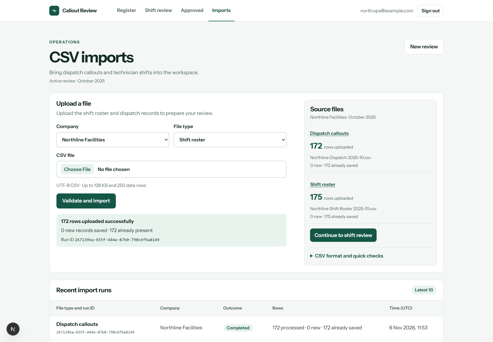
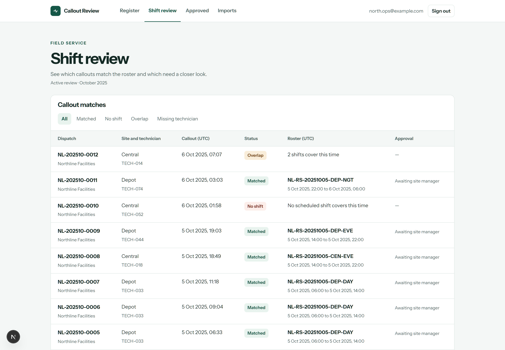
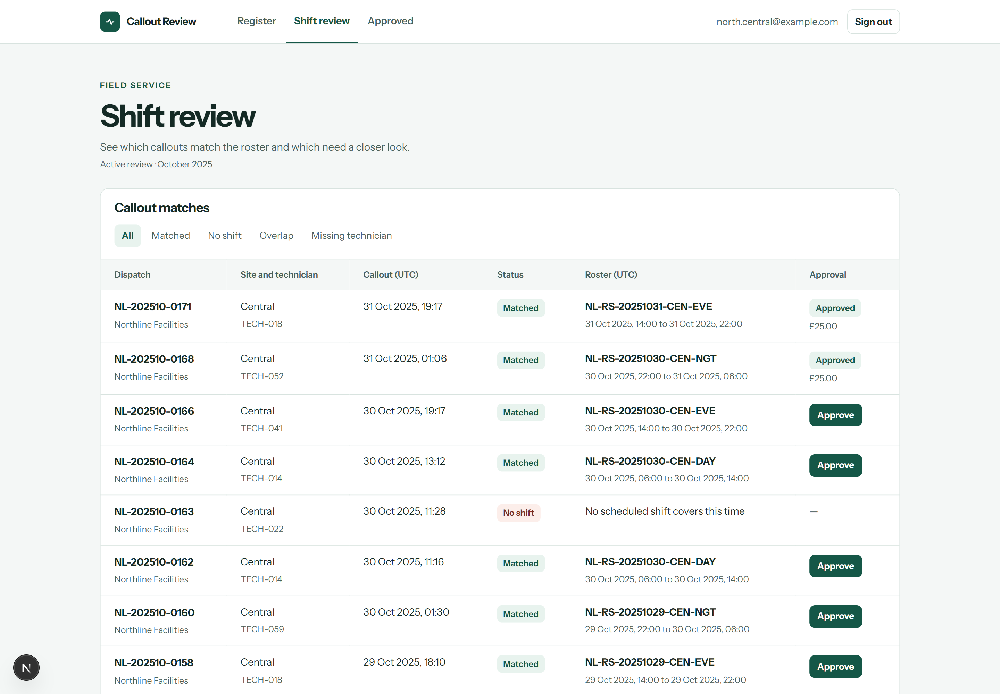
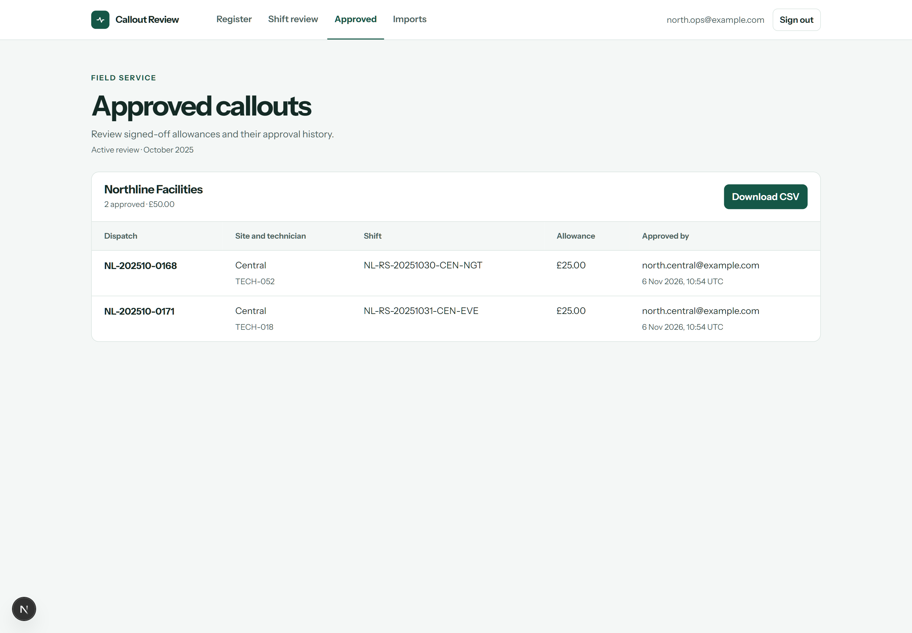

# Field Service Callout Review

Emergency callouts and technician shifts often come from separate systems. Before payroll, a facilities team needs to check which jobs had shift coverage, resolve scheduling exceptions, obtain site manager approval, and export the approved allowances.

This app brings that workflow together. **Northline Facilities is a fictional demo**, using October 2025 data: [172 dispatches](public/samples/Northline%20Dispatch%202025-10.csv) and [175 roster entries](public/samples/Northline%20Shift%20Roster%202025-10.csv).

## Walkthrough

### 1. Import the source files

Operations uploads the roster and dispatch CSVs. Each batch is validated before saving; identical rows are recognised on a retry. Source files shows the uploaded row counts, while Recent import runs keeps the saved outcomes.



The retry recognises all 172 dispatch records already saved; both source files are ready for review.

### 2. Review shift coverage

Callouts match on company, site, technician, and UTC time. The review distinguishes a single matching shift from missing coverage, overlapping shifts, and missing technician codes. Overnight shifts are supported.



Matched callouts show the covering shift; exceptions explain why a record needs attention.

### 3. Get the site manager's approval

The Central manager can approve eligible callouts at Central. Approval checks the current match and saves the reviewer, approval time, shift, currency, and allowance as a snapshot. Retrying returns the existing approval.



The manager sees callouts within their assigned site and can sign off eligible matches.

### 4. Export approved allowances

Operations reviews the approval ledger and downloads the active review's approved allowances as a CSV for payroll. The export uses the saved approval details, so later roster or rate changes do not rewrite an earlier decision.



The ledger keeps the approved allowance, reviewer, and actual approval time together for export.

Reviews stay available across sign-outs and account changes in the same browser. **New review** clears the working view for another run; saved records and approval history are retained.

## Tech stack

Next.js 16 App Router, React 19, TypeScript, Supabase Auth, PostgreSQL with Row Level Security, and `csv-parse`. The interface uses plain CSS and a locally bundled Instrument Sans font with its licence.

## Access and verification

| Role | Scope and actions |
| --- | --- |
| Operations administrator | Import and review records across the assigned company; export its approved allowances. |
| Site manager | Review and approve eligible callouts at assigned sites. |

Database assignments and Row Level Security enforce company and site boundaries, including direct record requests. Sign-in uses server-managed session cookies and a Supabase publishable key.

The repository includes **46 SQL assertions**. Each check script creates temporary fixtures inside a transaction and rolls them back:

| SQL checks | Coverage |
| --- | --- |
| [Access and integrity](supabase/checks/01_access_checks.sql) | 9 checks for company/site isolation and write restrictions. |
| [CSV imports](supabase/checks/03_csv_import_checks.sql) | 12 checks for validation, retries, rejected batches, and import permissions. |
| [Shift review](supabase/checks/04_shift_review_checks.sql) | 12 checks for time boundaries, overnight coverage, overlap, and visibility. |
| [Approvals and export](supabase/checks/05_approvals_export_checks.sql) | 13 checks for approval rights, snapshots, rates, totals, and export access. |

Automated app tests cover review persistence, account handoffs, explicit resets, metadata validation, and paged approval totals. Run the local checks with:

```powershell
npm.cmd test
npm.cmd run typecheck
npm.cmd run build
```

## Run locally

Use **Node.js 24.x** and npm.

1. Run `npm.cmd ci`.
2. If `.env.local` is missing, copy `.env.example` to `.env.local` and replace its placeholders:

   ```dotenv
   SUPABASE_URL=YOUR_SUPABASE_PROJECT_URL
   SUPABASE_PUBLISHABLE_KEY=YOUR_SUPABASE_PUBLISHABLE_KEY
   ```

   Use the HTTPS project URL and a publishable key beginning with `sb_publishable_`. Keep `.env.local` private.
3. Run `npm.cmd run dev`, open `http://127.0.0.1:3000`, and use an assigned account.

For a fresh Supabase database, apply the [migrations](supabase/migrations/) in filename order, create and confirm the users named in the [seed scripts](supabase/seeds/), then run those seeds in filename order. Run each SQL check as a complete administrative script in the Supabase SQL Editor. The existing demo project is already configured.

## Main folders

| Folder | Contents |
| --- | --- |
| `app/` | Pages, server actions, authentication, and CSV export. |
| `lib/` | Supabase sessions, CSV parsing, database types, and review state. |
| `public/` | Fictional CSV inputs and licensed font assets. |
| `supabase/` | Executable migrations, demo seeds, and SQL checks. |
| `tests/` | Automated review workflow and session checks. |
| `assets/readme/` | Screenshots of the application walkthrough. |

---

Built by James Isaac

[Portfolio](https://www.jamesisaac.dev/) · [LinkedIn](https://www.linkedin.com/in/james-bideveloper/)
